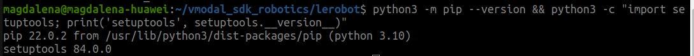
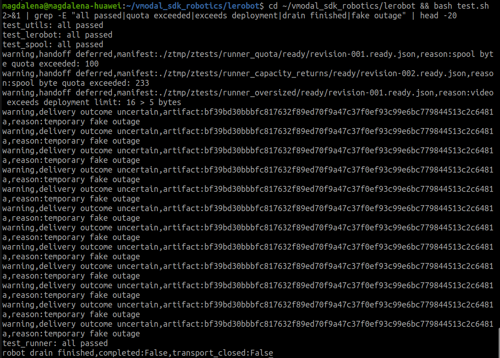
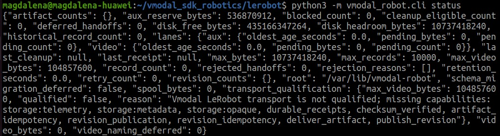
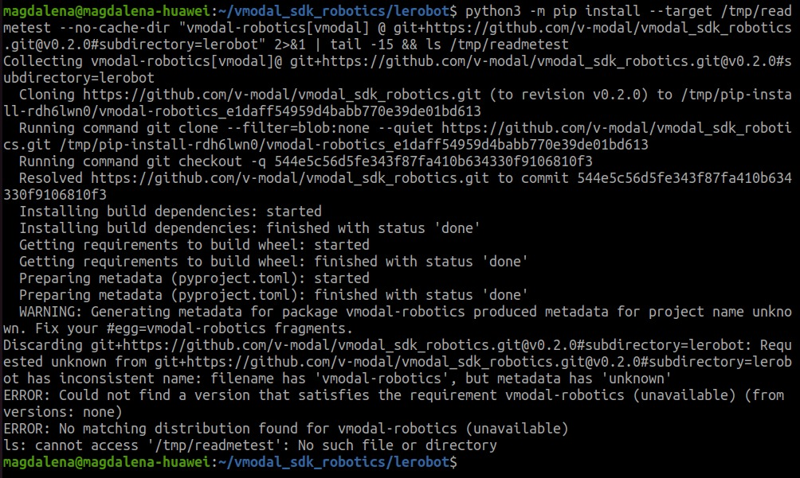
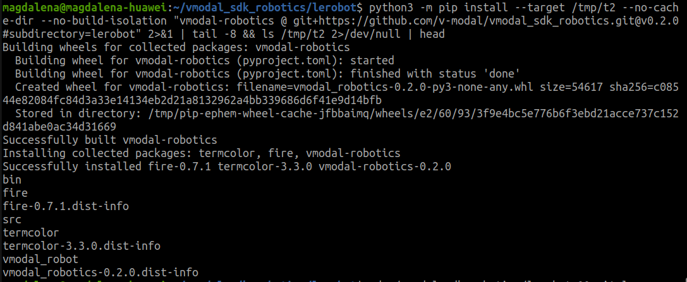

# VModal Robotics SDK v0.2.0 — would I put this on my AGV?

Tested on Ubuntu 22.04 / Python 3.10 / commit `fe16e8d` (tag `v0.2.0_run38217816021`)



I work on autonomous AGVs, so I evaluated this against a deployment I know: a robot
running an 8-hour warehouse shift with two Luxonis depth cameras (OAK-D Pro, OAK-D
Lite), detecting AprilTags for localization, and docking itself when the battery
runs low. New tags every 2–3 minutes.

**Short answer: not yet for a full shift, yes for short sessions.** Here's why.

---

## What's right about it

Network I/O stays out of the control loop. That's not a style choice on a moving
robot — an upload that blocks the loop stalls the vehicle mid-path.

And the failure mode it targets is the real one. On the deployment above, WiFi
dropped at *every* access-point handoff without exception, plus there were sections
of the building with no coverage at all. A durable local spool with retry is the
correct answer. Whoever designed this had met the problem in person.

The tests back it up. The suites pass, and the failure paths are forced with absurd
limits rather than mocked — a 100-byte spool quota, a 5-byte video ceiling — and the
retry path survives twelve consecutive simulated outages on a single artifact:



It defers instead of dropping data. The nastiest case is covered too — a delivery
whose outcome is unknown *after* the far side already accepted it:

```
warning,delivery outcome uncertain,reason:fake response lost after durable acceptance
warning,publication outcome uncertain,reason:publication ACK lost
```

That's what produces duplicate uploads in naive implementations. Seeing it tested is
why I'd track this rather than build from scratch.

---

## The blocker: two ceilings that close off opposite directions

`fixes_v1.md` says *"Discovery stops after 100 manifests."* And `status` reports a
hard per-file video ceiling of 100 MiB:



An 8-hour shift is 480 minutes. A tag every 2–3 minutes is **160–240 recording
events**. Two ways to segment that, both fail:

**One dataset per detection** → 160–240 manifests against a ceiling of 100.
Discovery stops around midday. The afternoon is never picked up, and
`rejected_handoffs` stays at zero because these aren't rejected — they're never
seen. Silent half-shift data loss, no alert.

**One long dataset per shift** → one manifest, ceiling irrelevant, but now the video
has to fit in 100 MiB. An OAK-D at 800p/30fps writes ~1.95 MiB per 16-bit disparity
frame, about 58 MiB/s — that's 100 MiB in **under two seconds** of raw depth. Even
compressed 1080p at ~4 Mbit/s fills it in three and a half minutes.

Fine-grained breaks on manifests, coarse breaks on video size, and nothing in
between clears both for a full shift.

Short clips are fine: ~10s of compressed 1080p is roughly 5 MB. **That's the
workload this version fits — short bounded sessions, well under a hundred of them.**

---

## Three more things that hit normal operation

**SIGTERM drain overrun fires daily.** `fixes_v1.md` lists *"SIGTERM exceeds drain
budget"* as a reliability item, which reads like an edge case. On a robot that docks
itself when the battery runs low, controlled shutdown is part of the duty cycle,
several times a day. I'd rank this higher than its placement suggests.

**No spool reclamation.** `"retention_seconds": 0.0` with `"last_cleanup": null`
confirms the `fixes_v1.md` item. There's a 10 GiB spool ceiling and no expiry to
keep it under that ceiling. Also worth sizing before committing: 10 GiB spool +
10 GiB headroom + 512 MiB aux reserve is over 20 GiB reserved, on compute modules
that often ship with 32–64 GB of eMMC.

**Stock transport can't upload — and says so.** The `status` screenshot above lists
10 missing capabilities, including `deliver_artifact` and `publish_revision`, which
are the two operations the SDK exists for. README lines 92–94 state this openly:
*"currently `run` and `flush` report missing transport capabilities."* So v0.2.0
ships the durability layer with the transport left as an integration point. A
blocker for deployment, not a defect. The other eight capabilities read as a decent
spec — `checksum_verified`, `durable_receipts`, and the two idempotency guarantees
are exactly what the lost-ACK test above is about.

---

## Install gotcha worth fixing cheaply

The README install command fails on Ubuntu 22.04 with the distro's stock pip:



Adding one flag to the same command fixes it:



One variable, two outcomes. Cause: `pyproject.toml` uses PEP 639 licence form
(`license = "MIT"` plus `license-files`), which needs setuptools ≥ 77, which emits
`Metadata-Version: 2.4`. pip 22.0.2 predates that and reads the name as `unknown`,
then rejects the mismatch. The metadata itself is correct — I checked a successful
build and `Name: vmodal-robotics` is written properly. Note `name` is static in
`pyproject.toml`; only `version` is dynamic, so this isn't a dynamic-version issue.

**Why CI misses it:** `test.sh` line 18 installs with `--no-build-isolation`, and
line 17 pre-installs modern setuptools. CI runs `ros2_test.sh` → `test.sh`, so every
CI install path uses the one flag that masks this. CI tests Ubuntu 22.04 / Python
3.10 and passes, while the README command on that same platform doesn't work. The
documented path is never exercised.

One more thing visible in that install: the wheel ships a package literally named
`src` alongside `vmodal_robot`.


In a shared `site-packages` that claims a generic top-level name — any other
distribution shipping `src` collides with it, and install order decides which one
wins.

---

## List of improvements

Ordered by what I'd want closed first.

1. **Raise or remove the 100-manifest discovery ceiling.** Causes silent data loss
   rather than visible failure, which makes it the most dangerous item here.
2. **Raise the 100 MiB video ceiling**, or document a segmentation strategy that
   clears both ceilings simultaneously.
3. **Close the SIGTERM drain budget** — fires every battery cycle on a docking robot.
4. **Implement spool reclamation**, or document the external cleanup job required
   until it lands.
5. **Ship a qualified transport**, or a worked example implementing the 10
   capabilities against ordinary object storage (S3, GCS, MinIO). For anyone
   evaluating this today that example is the difference between a day and a week.
6. **Add the ROS 2 manifest node.** CI already proves the SDK coexists with live ROS
   2 traffic (`ros2_test.sh` runs `demo_nodes_py` talker/listener and checks
   `/chatter` on both sides of the suite). What's missing is the step that turns a
   closed bag into a `ready.json`. Without it, integration stays manual — and manual
   steps don't survive a fleet.
7. **Add one CI step that runs the README install command verbatim** — distro pip,
   build isolation on, nothing pre-installed. Would have caught the above.
8. **Replace `python` with `python3`** in `test.sh`, `install.sh`, `cli.sh` and the
   README. CI symlinks around this; users following the README don't, so the first
   command they copy fails with `command not found`.
9. **Stop packaging the top-level `src` package** (see screenshot above).
10. **Fix the CLI program name** (help reports `NAME: -c`, Python's inline-code flag)
    and pass an explicit component to `fire.Fire()` — `--help` on the example
    scripts currently lists `List`, `Dict`, `os`, `sys`, `math` as commands.
11. **Clean up `MANIFEST.in`** — six warnings per build for `*.json`, `*.mp4`,
    `*.parquet` fixtures that don't exist.
12. **Document the spool root.** It defaults to `/var/lib/vmodal-robot`, which an
    unprivileged account can't create. Robot images need it provisioned before first
    run, or overridden.

---

## Verdict

Architecture is sound and the hard part is done. What's missing is scale — every
limit I hit is one a single 8-hour shift crosses.

Good fit for short bounded sessions: development, bench testing, a demo, one
recording run. Not for continuous operation. `fixes_v1.md` (dated 2026-10-10)
already names all of it, and `git log` confirms none of it is in this release.

Worth waiting for rather than rebuilding. I'd re-evaluate once the two ceilings move
and the drain budget is closed.

**Repo:** https://github.com/v-modal/vmodal_sdk_robotics/tree/main/lerobot
**Release CI:** [ROS 2 Humble](https://github.com/v-modal/vmodal_sdk_robotics/actions/runs/38218055362/job/114707355669) · [ROS 2 Jazzy](https://github.com/v-modal/vmodal_sdk_robotics/actions/runs/38218055362/job/114707355970)
